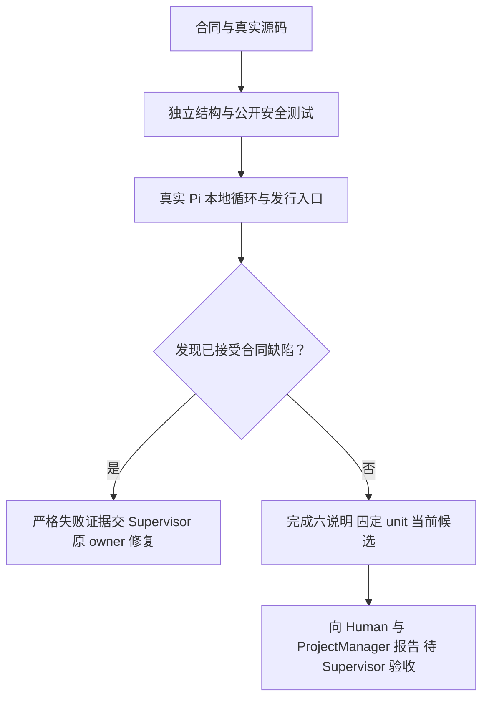

# 确认 Node 迁移保留权限，Pi 只能提出受控工具请求

依据[已接受 v3](../../../../design/2026-10-07_design_node-pi-v3.md)，本角色只写新 Node 测试和本阶段六份说明，不修改业务、治理或 Python 历史。先核对实际 Model/五层/公开 facade 与包白名单，再迁移原 P1 审批大小写/分隔符及 scalar 集合回归；补充本版合同要求的 typed API、单次许可、固定身份、撤销、审计与真实 Pi 会话隔离。

真实 Pi 检查使用已安装 1.0.4 公共 SDK 与官方 Faux 本地推理流，禁止 fetch。检查空资源与唯一 legion_write_file、实例/模型/provider 的隔离、取消及 late-create 释放、公开 modelProviders 数组和角色/任务/实例交集。下层 queue 只等待结果，不注入 Kernel callback。Finite 用例不重复 owner 全套，也不增加猜测性加固。

发行检查读取已稳定 tarball，核对 SHA、精确 27 文件及实际源码一致；测试 package self-reference 深路径被 exports 拒绝并通过 root 的 typed permission API。已安装产物 smoke 由 PM owner 留证，本角色不重建 tarball或写 PM 产物目录。

命令为 node --test tests/reviewer/test_structure.mjs；随机 workspace 位于 D:/work/code-work，递归清理前校验绝对路径和 lstat 父组件。现已实际执行22项，全部通过，零跳过；报告见 [review-node-pi-v3.md](../review-node-pi-v3.md)。最终 task_ops unit 在七文件完成后固定当前候选，之后不再编辑。受控 I/O 故障和 lstat 元数据注入用于检查真实分支，不宣称 native junction 或所有 reparse tag/恶意宿主隔离。

## 同版 Runtime.close 修复复查

独立 Tester 后续20项中19通过/1失败，正常 Runtime.close 先关 Mutation，使活动run的终态审计被误报失败，原失败记录保留。原owner现已修复，设计和配置继续冻结。本次Reviewer只检查同步撤权→完整activeRun/终态审计→Mutation.close的顺序、没有finally互等或把真实审计故障吞成取消；不重新设计或扩权。现已只读运行原严格close和实际auditfault两个有限集成用例，2通过/0失败/0跳过；现有22项回归也全部通过。测试仅更新合法重打包后的tarball pin，原P1及其他断言原样保留。正式新任务为[close-repair](../../../../scheduling/legion-pi-node-v3-close-repair.md)，文档最终完成后固定unit，生产/Model/Adapter/Tester源码与历史记录只读。
