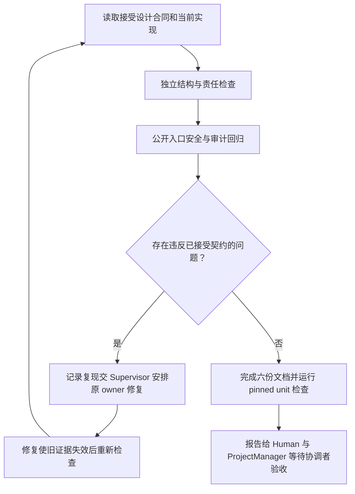

# 判断提案是否只能经过真实许可修改文件

Human 已确认 [legion-v1](../../../../design/2026-10-07_design_legion-v1.md) 并指示开发。本稿细化同版 Reviewer 检查，不新增业务行为或权限。

Reviewer 检查当前真实 Kernel 与 Adapter：从公开 Runtime 进入策略、单次许可、Mutation Service 和 Storage Provider；原始公共工厂不能因伪造 ALLOW 或许可产生写入。固定 Session、deny 优先、空范围、控制面、路径别名、任务/版本/边界回退、审计损坏和意图/结果审计失败都需要可观察结果。

结构检查将结合 AST 与人工读取，区分责任归属与调用方向：Model 纯不变量，Provider 拥有文件和时间，Policy 纯计算，Mutation 不回调同行，Pipeline 组合，Interface 只调用 Pipeline；Adapter 只引用共享 Model 并做本地转换。核查三段结构、明确公开出口、所有权、无三元/吞异常/跨对象私有字段与真实文档链接。

唯一写入为边界列出的 tests/reviewer/test_structure.py 和六份 Reviewer 文档。测试使用随机临时工作区，关闭并清理；故障注入限测试进程和临时日志。不会修复其他 owner 源码、测试、合同或配置。报告写入 [review.md](../review.md)，导航见 [feature-map.md](../../feature-map.md)。Reviewer 无独占业务功能，不增加 feature 文件。

检查命令为配置中的 unittest discover('tests/reviewer')，最终使用 task_ops run-check checkId=unit 固定候选和真实日志。正常公共 API 的保证不扩大到恶意 Python 私有导入、宿主改写内存或管理员竞争替换。历史 23 项含两个失败测试/5 个断言；owner 同版修复后，新分配 legion-v1-approval-repair 独立原样重跑 23 项全部通过，测试与断言保持不变。Reviewer 检查完成，协调者验收与 Tester 集成另行进行；源变化后重新收集相关证据。详见 [review.md](../review.md)。
