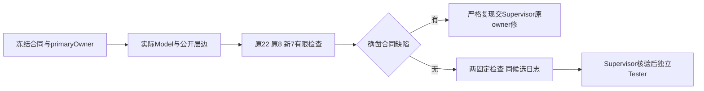

# Reviewer职责与有限审查流程

Reviewer向Human、ProjectManager及Supervisor交付实际结构、权限、IPC、凭据和包源一致性证据，不授业务权限，不代替Tester验收。当前工作台只有ProjectManager接收Human需求；点击执行成员只读，确认计划后才允许动态任务受控写入。

讨论阶段只产生userData项目/历史，客户目录无审计或业务创建；计划确认后workspace/.ans产生真实执行审计。确认绑定workspace、planDigest、版本、profile、context、role/task、精确writeSet/tools；取消、关闭和验证失败撤销整plan，不因恢复旧SHA自动复活。SDK文本结束不代表目标写入完成，软件检查保持not_executed。

本职责只改九个已派发文件，生成目录仅v2 Reviewer/node或desktop。旧Node22原审批别名/标量/伪造permit/审计断言保留；结构读取冻结ownership原始bytes先核SHA再取primaryOwner。声明限制与当前证据见[报告](docs/review-desktop-workbench-v2.md)。
