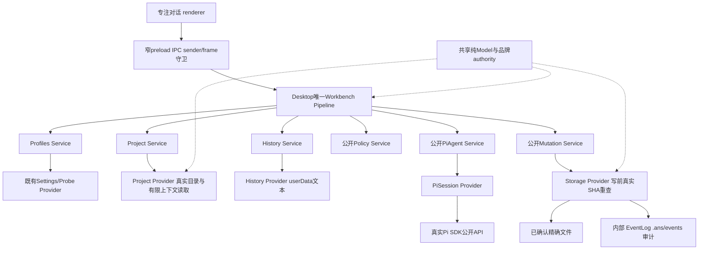
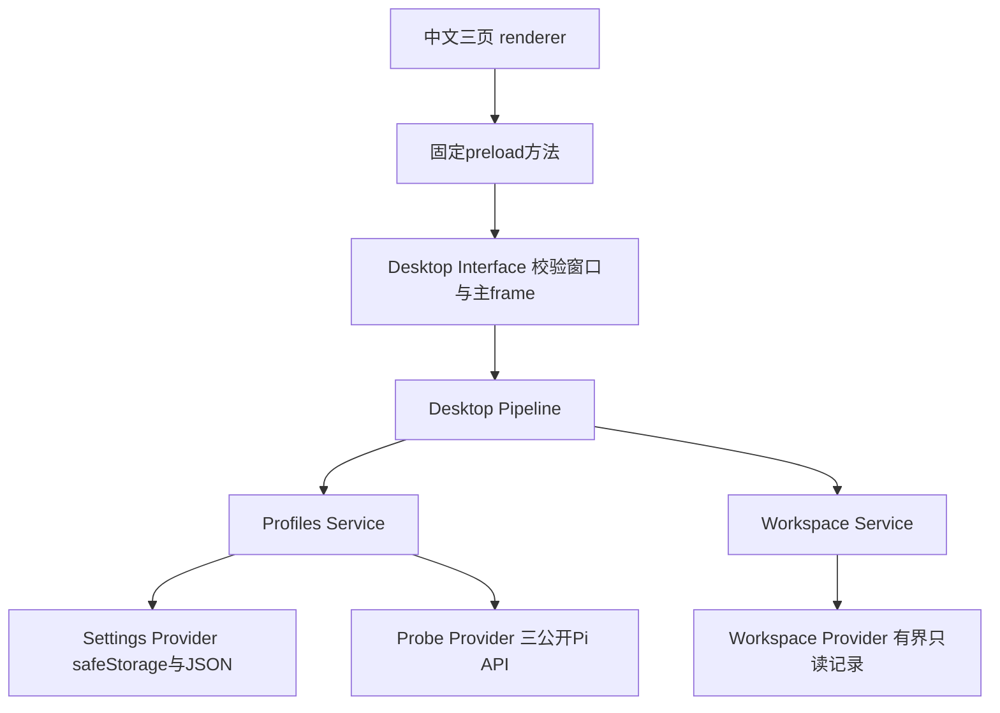
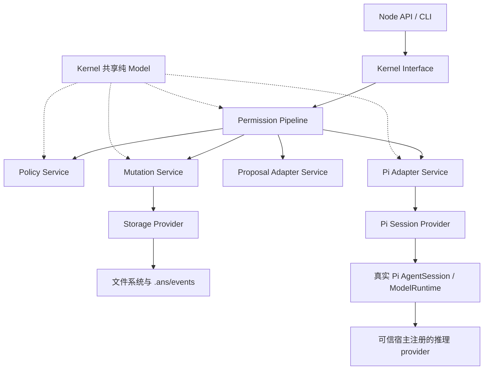

# Legion 当前架构：工作台 v2

工作台 v2已实现下图调用链，真实SDK、受控写入、审计和Windows窗口的成绩见 [当前交付](delivery-desktop-workbench-v2.md)。选择任意真实目录后，首条消息创建或复用唯一项目管理会话；同一会话讨论、确认和汇报。其他动态Agent只接受项目管理在已确认计划中的调度，Human不能直接chat/start。

讨论分支仅使用连接/项目/历史/Pi，无Mutation或客户项目审计。用户精确选择上下文后才产生品牌读许可，Project Provider通过纯Model assertForRead验证，不接controller；用户确认计划后才创建角色任务授权。Storage真实重查工作空间身份、路径链接和上下文SHA，验证失败使整份已确认计划的所有authority和待运行任务失效，恢复旧值不能复活；成功释放单receipt不影响其他合法许可。停止或close入口先同步撤权，再等待SDK与终态审计。旧requiredApprovals与控制面硬拒绝保持。

跨组件连接只经Service公开子路径，Workbench Pipeline不调用Core Interface或peer PermissionRuntime，Provider不回调上层业务。主进程保管解密密钥、实际会话和controller；renderer只获取安全DTO。Pi单次默认保持，新增conversation轮次终态回idle、轮次取消不销毁整个会话；实例关闭先撤销、取消和等待终态，再释放下层。

PM发行0.4.0精确29文件包和透明具名30纯Model/有限Service入口；desktop0.2.0实际安装本地tarball，实际ZIP含生产依赖，不依赖开发树/外部相对import。任务记录以16MiB/4096事件/64MiB刷新预算完整验证链与渲染一致性，缓存展示观察时间与最近真实验证时间。无任意Shell executor，生成测试文件不代表软件检查运行。

以下原型与Node v3内容为当时的历史架构说明，其中的“当前”“尚未实现”仅描述旧阶段；工作台v2按上图和最终交付记录运行。

GUI v1 使用独立 apps/desktop 包，三个页面负责 AI 配置、角色映射与真实记录观察。桌面不创建 Kernel Runtime、不调用其 Interface/Pipeline，也不启动角色任务。已交付 Node 产品仍保持下方独立执行链。

这是已核验原型的实际架构。客户最终要求唯一项目管理聊天入口，首条消息建立或绑定该项目PM、需求方案对话和Human确认后的动态Agent执行；独立Reception撤销，其他Agent只显示任务/状态。新工作台仍在只读架构评估，尚未实现跨桌面/内核的编排。开发Legion固定七角色不能当作客户项目组织。原GUI任务六节点verified、Tester暂不派发，原图不代表修订目标已接通。

桌面 DTO/Model 主责 DesktopEngineer，核心 Model 主责 KernelEngineer。密钥初输保存后清空，状态只回 hasSavedKey；解密失败不明文降级。治理接受、task_ops记录状态和运行审计分别投影，治理snake引用与Kernel camel镜像分别校验，缺失/损坏/未知显示 unavailable 和记录/刷新时间，不声称进程在线。

当前实施与验收见 [GUI交付](delivery-desktop-gui-v1.md)，总体用户方案见 [GUI canonical](../../../design/2026-10-07_design_desktop-gui-v1.md)。以下为保留的 Node v3 执行架构。

产品使用单个纯 ESM npm 包，Pi SDK 与 Legion 在同一 Node 进程内运行。公开 package 入口仅暴露 Kernel Interface 受控 facade 与必要配置 Model，CLI 提供 permission demo。原 Python v1 文件为只读历史；task_ops 的 Python 只用于开发证据管理。

Interface → Pipeline → Service → Provider 是实际调用边。Provider 的自定义工具排队 `PiToolRequest` 并等待结果；Pipeline 从 Adapter Service 拉取请求，绑定可信会话，交给 Policy 与 Mutation，再经 Adapter Service 返回 `PiToolResult`。Provider 不持有上层 submit、权限或文件执行 callback，Service 不调用同行 Service。共享 Model 的唯一 owner 是 KernelEngineer。

创建时 scope 必须位于接受角色与任务精确文件、工具集合内；运行时重验当前组织版本、边界、任务状态、实例/run 和原始会话对象。name 与模型载荷不产生权限。许可绑定资源和内容且不可复用，完成、取消或变更撤销旧授权。拒绝优先，审批比较采用与范围检查相同的资源规范化，集合字段拒绝 scalar string 并防御性复制。

Pi Session、Settings、凭证和模型配置使用显式内存实现，资源发现为空，唯一 active tool 是 `legion_write_file`。一次实例运行一次任务，完成、失败或取消释放会话。受控测试 provider 参与真实 SDK 推理，不替代 SDK Agent 循环。proxy 表示模型 provider/model 连接，本阶段没有启用 HTTP/SOCKS 配置。

Runtime.close 先同步撤销权限，停止 Session，等待完整活动 run（含终态审计），最后关闭 Mutation Provider。run 的 finally 不反向等待 Runtime.close，避免互等；正常取消返回 cancelled，真正审计故障仍返回 failed。这个时序由原严格集成用例、独立评审和141项公开入口验证覆盖。

Node Storage Provider 用工作区共享队列协调每次文件或审计操作，内部审计写入 `.ans/events/index.jsonl` 与日期 JSONL，提案对控制面写入仍拒绝。执行前审计失败不改文件；替换后的审计失败保留 `observedMutation` 并停止后续写入。文件与两份日志不构成跨文件事务，本地受控 API 不声称隔离恶意同进程宿主或并发 OS 攻击。

固定输入见 [接受设计](../../../design/2026-10-07_design_node-pi-v3.md)，当前有界关闭修复见 [执行记录](../../../scheduling/legion-pi-node-v3-close-repair.md) 和 [Node 交付](delivery-node-pi-v3.md)。[原 Node 任务](../../../scheduling/legion-pi-node-v3.md) 与 [v1 交付](delivery.md) 保留历史结果。
