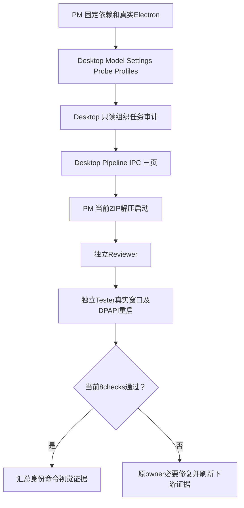

# GUI v1 分段执行

2026-10-07。客户已确认 [canonical GUI v1](../../../../design/2026-10-07_design_desktop-gui-v1.md) 并回复“开发”，本版 O1 未选。治理冻结精确69 authored路径，业务阶段62文件与本角色7说明分别记录。此处不是新增产品设计或额外批准。

deps和profiles内部按各自层次推进测试，verify后冻结。角色一次绑定终身，DesktopEngineer新独立上下文，不继承治理/调度历史；原PM/Reviewer/Tester仅复用原角色。最多两个worker，工具容量不足则顺序执行，不复制writer。

记录只由task_ops写入 [legion-desktop-gui-v1](../../../../scheduling/legion-desktop-gui-v1.md)。配置e72ba37fc080453ecf9ef0229c5f6f11bf4e41ecf017cf2febf85cea6ef6d89d；设计58c79cae70bc45dcdda038e0e7944883dbee3ecfb2e277664a5954c3ec6a398d；客户授权f6d9f891f4046d16785eefdd3516578556da857e53bfcb4cbf907d4f94194ad2。摘要固定输入，直接消息才是实施授权。

真实Electron、DPAPI保存重启、三协议请求、当前ZIP启动与视觉检查不能跳过。产品原Core/Adapter/root包不变，旧141项不是GUI证据。当前结果见 [交付](../delivery-desktop-gui-v1.md)。

客户修订后，本图保留为原接受计划。实际 revision36 六节点 verified、Tester pending且未派发；不继续把配置观察面板验收为最终产品。新的真实聊天、项目专属PM、Human确认后的动态执行与工作台设计正在只读评估，待新方案及精确治理范围，不改原冻结输入。
