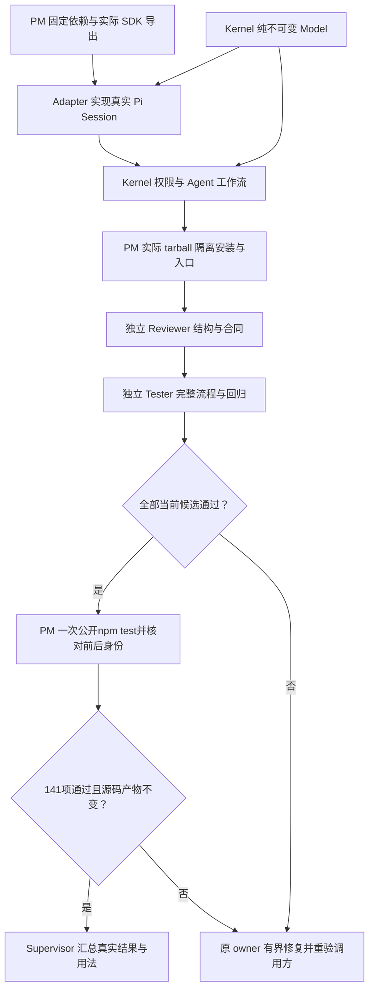

# Node + Pi v3：分段实施与证据交付

日期：2026-10-07。状态：同版授权实现与关闭修复已完成当前验收，七节点均 verified，无活动 worker；公开 npm test 141/141通过、0 skip。

客户希望用名称、模型连接和范围创建 Pi Agent，并把整个产品运行切换为 Node，便于安装发行。[固定设计](../../../../design/2026-10-07_design_node-pi-v3.md)经独立 ProjectManager 与原固定工程 owner 评估，Governance 已落实精确权限；本上下文只承担 Supervisor 调度与交付说明。

## 分段原因

共享 Model 与 npm 依赖先固定，后续 worker 读取同一合同和真实 SDK。Adapter 提供独立 Pi Session 与工具队列；Kernel Pipeline 组合 Service，执行权限检查后才回送工具结果。打包等待真实实现，独立 Reviewer 与 Tester 最后检查组合候选。每段精确 writeSet 不覆盖已验证的前段输出，修复必须回到原 owner 并刷新受影响证据。

deps 与 model 可并行，实际工具容量不足时允许顺序运行。最大两个 worker；角色固定一生，worker 不派发其他上下文。实际图和日志只由 task_ops 维护于 [原任务记录](../../../../scheduling/legion-pi-node-v3.md) 与 [当前关闭修复任务](../../../../scheduling/legion-pi-node-v3-close-repair.md)。后者保留同一冻结设计和七节点图：前三输出未变，只读重验；Kernel 等待运行取消及终态审计后关闭 Provider，再刷新下游包与独立验证。

## 固定输入与检查

- 直接授权见 [治理授权记录](../../../../../.ans/decisions/legion-pi-authorization.md)，内容 hash 仅固定输入，不产生批准。
- canonical design SHA256：`342fd522343126c31c7a7f1ee3c8befab9f363d5372297847ebc8f42b5f30bae`。
- execution config SHA256：`25e46e9b7811685847116393d9c9982062e975f66e151ce3d094ef2be020cccb`。
- Pi coding-agent 与 Pi AI 固定 `1.0.4`，依赖安装关闭脚本并使用项目局部缓存。
- Model、Adapter、Kernel 分层/完整回归、权限 demo、真实 npm tarball、独立结构和集成检查均以 [执行配置](../../../../../.ans/project.json)的 argv 运行。真实 SDK 缺失或未运行必须失败，不跳过。

任务候选由各节点 readSet/writeSet 内容生成；实际安装版本、lock 完整性、测试环境与产物另记证据。`node_modules`、npm cache 和 packaging 临时输出是 ProjectManager 的有界生成副作用，不作为 authored 源码候选。

## 验收与历史

完成要求七节点均 verified、无活动 worker，当前组合候选经过独立验证，owner 说明与真实行为一致。最终证据见 [本阶段交付](../delivery-node-pi-v3.md)；实施期间该文档不会把待验证项写成通过。

当前已满足：14 required checks 全部 exit0；Kernel74、Adapter23、package2、Reviewer22、Tester20组成公开入口141项，各套件0 skip。末次入口同时通过package重生成与Reviewer字节核对，源码/lock/测试/tgz身份不变。真实Pi在同进程运行，离线推理使用官方Faux，不宣称已实测付费模型或全部Windows reparse标签。

原 Python、旧政策快照、phase1 设计与 [v1 交付](../delivery.md)保留只读历史；原 101 项通过不是 Node 迁移证据。产品发行包不包含 Python、task_ops、治理配置或测试缓存。
