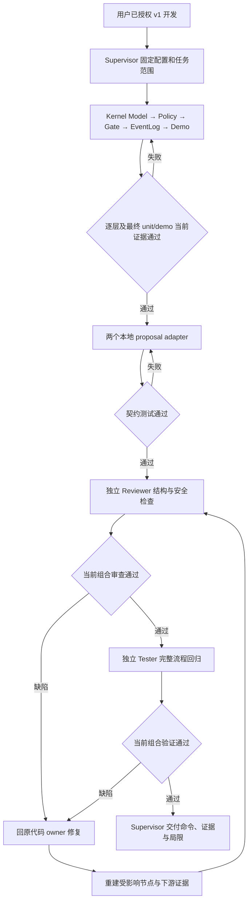

# 逐阶段完成权限演示

Backend 提案可以写本角色的 backend 文件，但不能写 frontend/login.vue。要让这个差异可运行、可复现，先由内核 owner 建立固定身份和判定，再让受控 gate 在真正写文件前复核；两个本地适配器只转换提案，不能授予权限。

本记录组织执行顺序，行为与范围沿用客户已经授权的 [Legion Runtime v1 设计](../../../../design/2026-10-07_design_legion-v1.md)。没有增添选装。实际系统与角色协作见 [架构](../architecture.md)，业务完整流程由各 owner 的功能文档说明。

每个执行节点使用 owner 的完整配置 writeFiles 作为精确 writeSet 与 requiredOutputs。kernel 检查为 unit 与 demo；adapter、reviewer、tester 各自使用其 unit。上游摘要、合同、设计或相关输入变化会使依赖证据失效。

调度记录只由 task_ops 写入。Worker 仅获得自身 assignment credential，不能自验收或创建子 worker。Supervisor 的文档属于已接受 Section 1 的调度职责，不冒充工程实现。

实际命令、候选与结果已记录在 [交付说明](../delivery.md)。原内核与适配器 owner 检查后，独立 Reviewer 复现审批路径别名及 scalar string 边界集合两个 P1。新的 [有界修复任务](../../../../scheduling/legion-v1-approval-repair.md) 沿用接受范围、合同和配置，原 Kernel owner 最小修复后，当前 Kernel 47、Adapter 14、独立 Reviewer 原样 23、独立 Tester 17 项及 CLI demo 全部通过。四节点已经验收，原开发记录不作为当前验收。此修复不改变客户需求或权限范围。
