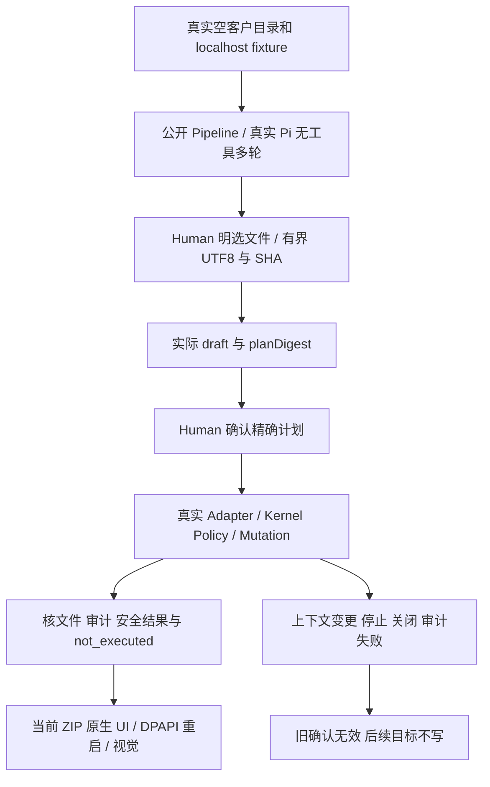

# Workbench v2 独立有限验收设计

2026-10-07，固定 Tester；依据 canonical `715639b5dd278437059f29bde1e7c02ac90d94af18f9bf5a6b5367d16e9ab5d3`、config `2546ebd0…`、desktop-workbench 合同与本角色 Section 1。客户已确认同版；本任务仅十文件，生产由原 owner 修复。

两个桌面测试文件承担有限完整流程：真实 Electron 的公开 Workbench Pipeline 与已安装 Pi SDK，经 localhost 协议推理，完成无工具多轮、两个客户项目隔离、Human 精确上下文与计划确认、动态任务写入/拒绝、整计划失效、停止/关闭、审计故障和缺少目标文件。SDK、会话与文件效果不替换；仅受控推理响应及明确的存储故障刺激。缺 SDK、真实窗口、DPAPI 或协议失败不能 skip。

实际发行 ZIP 从当前 PM descriptor 读取身份，解压到 Tester fixture 后逐字节核 shipped source 与 runtime，再启动实际 exe。通过所属 main PID 的原生目录选择器选真实目录；操作对话/设置/抽屉，确认前零客户写，确认后实际文件与审计。退出重启相同隔离 userData，验证本机 DPAPI 解密认证、历史保留且不自动推理；检查浅/深色、最小窗、文本安全和轮询保留草稿/连接选择。

旧 Node 两 integration 只迁到本阶段 `<role>/node/tmp`；原二十名称、断言和清理守卫保持。最后文档完成后仅两 approved checks：桌面两文件 serial/300s；固定 wrapper 的公开 root npm test/300s（child280s）。不逐子例重复预跑。Caller role=Tester，TEMP/cache 均本角色新阶段，清 Node options；所有数据/截图/进程仅六目录。结束记录实际 candidate/logSHA/counts/protected hashes，交 Supervisor；不自行验收。

限制：localhost 不是付费服务验证；DPAPI 只证明本机重启；原两个 junction 回归为本机 EPERM 下的 lstat 元数据刺激，不证明 native reparse/OS 或恶意同进程隔离。软件检查没有执行器，必须 not_executed。

当前行为与结果见 [verification](../verification-desktop-workbench-v2.md)；实际结果以同候选 approved evidence 为准。
