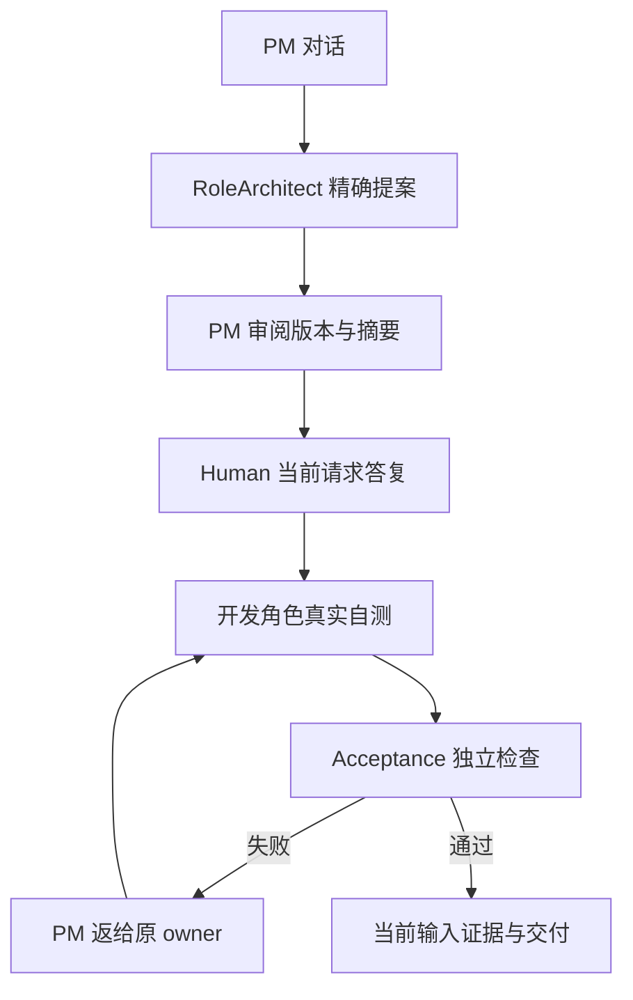

# 用真实执行检查项目协作与交付

本方案落实已确认的[完整组织工作流](../../../ProjectManager/docs/design/2026-10-08_design_legion-governed-workflow.md)，没有新增产品行为或权限。Tester 只修改本次派发的十二个测试和文档文件；生产实现、其他角色单元测试和治理配置只读。生成夹具、独立 Electron userData、临时文件、截图与证据限定在 `.ans/runtime/legion-governed-workflow-v1/Tester/` 的已批准子目录。

用户从 PM 对话提出需求；测试通过真实安装的 Pi SDK 和本机受控 HTTP 协议发送工具请求，让 RoleArchitect 提案、PM 审阅、Human 答复当前执行请求，再运行开发和 Acceptance。软件检查必须经实际公开 Check Service 启动隔离 Node 测试，断言候选内容和实际效果，不接受模型自报通过。

必须覆盖持久 Human→question→answer→PM continuation 顺序、同文字不同消息 ID、重复 answerId 不重复、重启/未来轮次不移动旧答案、旧无锚点顺序未知标注，以及真实 propose 后 SDK 失败保留同实例确切 pending 提案（仍 error、decision false、不批准或授予权限）。必须覆盖持久成员跨计划、纯讨论无源码变更、三类交互关闭/答复/重启、过期 nonce 和重复确认拒绝、未批准角色/无 checks/无独立覆盖拒绝、开发检查成功及失败、独立验收失败与限定返修复验、输入改变使旧证据失效、Acceptance 越权源码拒绝、PM/架构师只读与本角色文档范围、取消/关闭撤销、旧写入审计/编辑/三协议/项目隔离/CAS 回归。UI 用独立实际 Electron 窗口，验证弹窗及焦点/输入稳定、成员与证据状态；Windows ZIP/DPAPI 明确只能在 Windows 运行，macOS 不宣称通过。

正式命令采用配置中的 `integration` 和 `ui` argv，均通过 task_ops run-check 执行并固定候选与输入摘要。依赖还在变化时只准备或诊断，正式证据等待源冻结；任何相关输入变化须重跑。发现生产缺陷将准确复现、预期/实际和原 owner 返回 Supervisor；Tester 不修改生产。

证据写入[验证记录](../verification-governed-workflow-v1.md)。通过只证明实际列出的当前 macOS/Node/Electron/SDK 场景；客户 SSH 项目和原生窗口由 Supervisor 独立记录，不能用旧阶段结果替代。

## 2026-10-09：及时雨 / Handwell 生产界面独立验证

客户已确认[ProductDesigner 的近黑界面与双语品牌方案](../../../ProductDesigner/docs/design/2026-10-08_design_legion-ui.md)，本次使用 `legion-ui-handwell-implementation-v1` 的正式 Tester 五文件派发。只更新两份现有 E2E 与本方案、验证记录、changelog；业务源码、公开 API、权限、integration helper 和其他角色测试只读。旧通过与失败证据保留，新截图/JSON/诊断位于原已允许生成范围 `Tester/evidence/handwell-ui-20261009/`，唯一 mkdtemp 夹具/userData 只清本次创建项。

实际 Electron 页面、preload/IPC、受控本机 SDK 协议、实际 Node 软件检查是验证入口；离线原型的七成员和模拟状态不是通过证据。覆盖近黑默认与浅色、1260×860/960×640实际窗口、中心欢迎输入和内容后底部输入、稳定真实成员及状态名称、四页签620px任务浮层、精确上下文/归属/转交、全部实际成员设置映射、当前来源/真实检查/独立验收/原角色返修。

三类弹窗必须验证输入、关闭/Esc/同nonce草稿恢复、错误及过期时保留输入、完整执行范围/checkspec/Acceptance覆盖/返修次数及公开绑定可读、独立内容滚动和固定可见footer。保留原欠nonce/普通对话不授权、凭据拒绝、编辑SHA、取消/停止、实例/项目隔离断言。键盘测试覆盖Enter换行、Ctrl/Cmd+Enter发送、IME合成不派发、页签键盘和关闭后焦点；后台轮询须保持草稿、当前输入/成员/message节点、滚动和打开详情，不抢焦点。减少动画模式不影响真实操作。

旧布局依赖改为明确进入目标页签再断言可见结果，不用DOM存在替代可读/可点击。普通回复完整显示且不重复原文，含legion-plan仅安全可查看原始文本。所有状态从当前 DTO 与实际执行取值，不硬编码样例成员/SSH/模拟scenario/CANDIDATE。正式检查仍用配置固定 integration/ui argv 与原超时；生产缺陷直接交原 owner，不修源码、不删断言、不扩scope。

本轮另用真实 Chromium 执行生产 `_Renderer.region` 的限定 DOM 合同测试：受控同ID事实变更替换 disclosure，不使用伪 SDK/host 结果替代完整流程。答复失败焦点用本次独立 userData 的真实组织锁制造 `organization_busy`，通过真实 renderer/preload/IPC/Provider观察答案、错误、按钮与焦点。若断言失败交回 Desktop；其证据必须标明真实宿主与受控 DOM 输入各自的范围。

最终 `legion-ui-handwell-final-v1` 使用相同五文件范围与原固定checks。此前真实UA焦点A失败由原owner修复，原严格断言复验；B真实host失败继续通过。最终所有新截图/JSON用 `handwell-ui-20261009/final-v1/`。host terminal 与 renderer 每秒消费状态分别同步，真正按钮enabled后仍严格断言；浮层/modal背景操作按实际关闭/重开同nonce执行，不forceclick。明暗截图等待实际CSS主题paint稳定；正常/不可用来源文字按真实DTO验证；日志stdout/stderr逐个验证可见。完整最终结果链接当前任务而非覆盖旧结果。

final-v2保持原严格UA/真实宿主B复现条件、全部新UI矩阵与Mac回归，只更换新的final-v2输出prefix和准确idle title/AX观测。final-v1正式B失败保留；修后必须同scope/同fixedchecks当前执行通过，不用局部通过或原owner139单测代替。五文件最终冻结后只完成必要正式integration/ui，任何真实阻断原owner处理，Windows仍如实未运行。

final-v3最后微小CTA源变化须刷新完整门：同批准5文件仅新输出prefix，原实际欢迎配置入口点击与两实际nav标记核对，其余原严格UI/UA/host矩阵和fixedchecks不变。旧final-v1/Bfail、final-v2当前pass均保留；当前两formal各一次，任务记录固定结果，不用原型、metadata或旧通过替代。

### 2026-10-09：Markdown 与导航焦点纠错的独立验证

`legion-ui-markdown-and-focus-v1` 同客户配置和Tester五文件范围。旧全部版本、失败和通过证据只读保留，新输出仅 `handwell-ui-20261009/markdown-focus-v1/`。使用安装的marked18.0.11本地UMD及真实生产renderer/main/IPC：实际SDK回复得到h/strong/em/list/quote/table/code/link安全DOM，用户/Human保持literal，原始回复精确可读，闭合/未闭合legion-plan从visible正文移除而raw保留；没有lexer的纯文本fallback说明有界并不丢内容。

安全验证不插rawHTML，不执行script/unsafe schemes，不自动请求图片或外网；真实mouse/Enter触发exactHTTP(S)链接时，只把末端OSopener替换为明确的受控spy，main实际gesture/frame/URL/one-use检查保留，synthetic/programmatic/旧绑定/close拒绝。该OS边界替身不当作系统浏览器或客户外网验收。实际UA测单项目mousedown/up/focus/Tab/Enter/scroll几何和member Esc selected解除、起点内侧可见焦点；真实多长项目的合法纵向scroll不能屏蔽。保持原完整host/软件检查/独立验收/返修/nonce/crypto/A/B/三popup以及960/lightdark/草稿和阅读滚动，不用旧literal Markdown比较逼rich text退化，不拓CommonMark无穷样例、不改固定argv/budget。正式两门在5文件冻结后同candidate执行。

### 2026-10-09：角色持续记忆与五页签的独立验收

本轮正式任务为 `legion-persistent-role-context-and-dialogue-v1`，只修改 assignment 的三份独立测试及三份 Tester 文档。验收落实已经确认的[角色持续上下文与成员对话设计](../../../ProjectManager/docs/design/2026-10-08_design_legion-governed-workflow.md#handwell-角色持续上下文与成员对话设计)，沿用精确角色权限与相邻层约束，不新增产品行为。

完整流程继续从实际安装的 Pi SDK、Workbench Pipeline、隔离 Electron renderer/preload/IPC 与真实软件 Check 入口执行。记录受控 localhost 请求，核对 PM、RoleArchitect、Builder、Acceptance 在新任务、原角色返修、需求讨论和重启后携带自己的文字记忆；当前 canonical 职责、revision/digest、归属和任务必须完整，旧工具/yes/检查不成为新授权。单独经公开 Adapter Service 验证 fresh single_run 一次恢复、实例和 profile 绑定、运行后拒绝与旧工具拒绝。

摘要场景通过公开 Organization Service 造本轮隔离的持久原文，然后让实际宿主/SDK处理：49152 字符、96条、完整新18k Human 配旧45k文字、65536合并上限；同实际profile的一次无工具摘要、2048输出限制、成功水位去重与 choice 题目/选项/答案。失败、超长、工具输出、取消、同项目CAS冲突均检查原文与覆盖水位，保留真实失败日志；保存取消若已提交必须如实反映。旧无roleMemories文档先校验raw摘要再迁移，原始archives保留，现有存储上限不变。单元证据只引用真实Owner结果，不能算作本次独立入口通过。

五页签顺序固定为任务、文件、成员、对话、记录。独立窗口验证 Sidebar→成员、working入口→对话、共享selected role、PM timeline与其他角色journal隔离、真实系统/项目/来源未记录标签、event DOM/焦点/阅读位置/草稿/Esc。旧键盘断言严格加上对话页而不删权限、scroll、弹窗和Markdown回归。窗口保持 hidden，仅webContents.focus后发送真实native packets；这证明Electron收到native事件，不声称OS物理键盘验证。

正式 `integration` 与 `ui` 使用批准配置原argv和300秒上限，经task_ops记录同候选；截图与新的JSON放 `Tester/evidence/role-context-20261009/`，本次唯一夹具/userData清理。源有变化就刷新所涉证据；发现生产缺陷交回原Owner。真实Windows、外部模型与客户SSH开发不在本轮已执行证据内。

本轮随后收到客户去除成员列表可见滚动条的明确要求。原Owner仅改该列表CSS；独立UI使用真实旧owner迁移出的长成员列表检查无占位bar、滚轮和键盘仍可浏览、既有成员DOM身份稳定，并保存指针位于列表内的截图确认可见呈现。其他阅读滚动与权限回归继续保留；这是实际浏览行为/截图观察，不新增CSS源码镜像断言。正式两门等待此最小CSS修复verify后再运行。

### 旧取消轮次的真实 Human 消息合同

正式integration首次33/34，旧只读Workbench用例按三轮完成聊天预期6条，实际第3轮取消的完整Human同样保留，得到7条。协调方在同已批准配置下另派固定Tester一文件补充任务 `legion-role-context-cancelled-human-assertions-v1`，只授权现有 `workbench-flow.test.mjs`。修正两处旧6条期望，并严格检查额外条目确为取消轮次Human原文且仅一次、顺序正确、SDK恢复不含已取消partial助手文字、原始timeline仍保存partial事实、另一项目不携带该Human、回原项目历史完全一致。原PM身份、取消、权限和项目隔离断言保留。主六文件与补充一文件统一冻结后先跑补充原integration，协调验证后刷新主原integration/ui。

补充正式流程再观察到旧模型回调一边prepareCandidate改catalog/夹具，一边getState读snapshot，产生安全context_changed。协调方已授权同一Tester补充文件的必要夹具时序修复：准备候选移到现有send启动真实SDK之前，模型回调只响应请求。原变更检测、错误与权限断言保持，不通过重试或吞拒绝取得通过。

### 2026-10-09：依赖交接修复后的调用方复验

真实SSH执行中，Core已产生9文件90787bytes及28条真实自测通过，Renderer在SDK启动前被原65536模型输入预算拒绝。原自动依赖交接把父任务写入正文全部灌入继任prompt；新已验证实现交接六字段 `resource/taskId/roleId/action/contentDigest/proposalDigest`，按实际完成顺序筛选本任务依赖、同资源保留最新成功变更。完整write先由实际UTF8正文求SHA再丢弃临时body，edit使用真实结果SHA，缺少实际SHA为null。继任通过已有legion_read_file读当前磁盘，不据旧body/SHA推定当前数据。

本次正式Tester任务 `legion-bounded-dependency-verification-v1` 只允许三份自身文档，不改生产或既有测试，不新增或复制Owner案例。已只读核对纯Model与Pipeline入口及Owner当前actualtrace：大于78k的三个父文件、重复write、真实check失败、read/edit/pass，继任保留完整Human/canonical和最新edit SHA，自主读取全文SHA、写自己scope、自测与Acceptance通过。Owner Model33/unit193是开发证据，本角色用原fixed integration/ui刷新实际完整调用方门；旧34/Mac6成绩保留为历史，不能覆盖本次源码候选。

预算、权限、Human nonce、完整当前上下文和原始archives不扩大或截断。元数据本身仍可能超出固定预算并被明确拒绝；交接SHA不是授权或当前检查证据。测试只证明本机受控SDK/Electron与原完整caller合同，真实Windows、外部模型和Root普通窗口重新PM确认/后续SSH执行分别记录。三文档冻结后只运行规定门，若旧测试确实依赖自动body则先报告精确位置与scope，不通过吞错误、retry或弱化断言过关。
