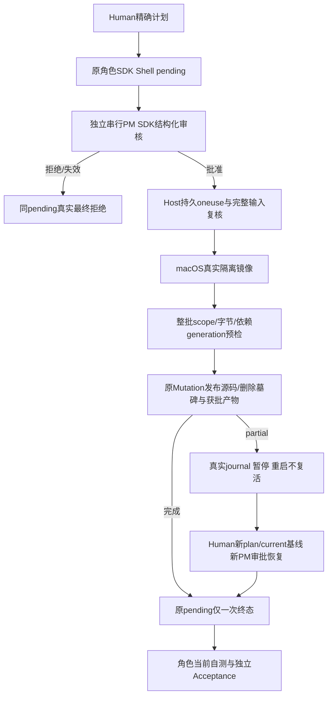

# 命令回到原角色，交付仍由真实检查证明

本方案实施已真人确认的Shell v1与c872精确配置；本上下文继续固定Tester，不修生产。独立入口为实际安装0.8.2 SDK/Workbench/公开Kernel能力、macOS native隔离及真实Electron。角色申请后由真实独立PM SDK逐条决定精确request/digest，不用模型文字或测试假审批器代替Host许可。

四个新测试分工：Node公开Shell/Adapter验证精确审批、一次consume、真实候选/发布与否定权利；必需macOS探针验证真实子进程/管道/离线npm、网络none/localhost、人工canary/原目录/控制面隔离、危险链接、脱离树/timeout/cancel和readonly依赖。Desktop完整入口验证PM队列不占主tail、原实例/任务保持、source UTF8/binary/安全exec/delete以及generated发布、只读.bin构建、检查/Acceptance、partial暂停与新Human确认恢复。GUI用hidden真实窗口操作，观察waitingPM/executing/publishing及原成员对话、PM理由关联、五页签/节点/焦点/阅读/draft/Esc/来源/隐藏bar。

Host时间每阶段由Service/Provider观察fresh事实，Model不取环境时钟，SDK不收clock；原Human/currentcanonical/预算/权限不截断或扩大。generation直接复用prepare给出的opaque输入事实；只读依赖变化整批拒绝，only-dist不能发布node_modules。未运行、Shell exit0、部分发布与recovered分别说明，原日志不回写。

效果仅Tester新Shell阶段fresh目录。四个旧fixture只迁fresh输出及新设计必需的精确SDK工具枚举；旧包/日志/历史proof保留。固定package/latest bridge-v3 JSON检查前保存完整bytes/SHA/mode/path/原日志关联，检查后另存新snapshot；不声称旧路径hash不变。六configured gates采用原argv/300s、同冻结16输出候选；macos_probe_required实际>0、0skip/todo。CLT/native失败unsupported即失败关闭，不裸fallback；真实Windows/外网/客户SSH未执行如实记录。

方案属于同canonical已授权验收，测试尚待实施和运行。当前功能导航见[本角色Shell验收说明](../feature/project-shell.md)。
