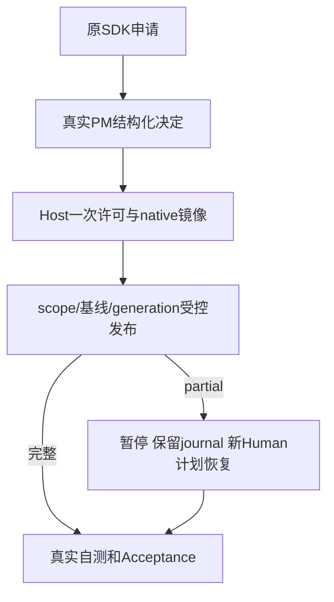

# 验证命令实际完成且没有获得额外文件权限

Tester没有直接业务功能。它从真实角色SDK/PM审核、原Host入口、native隔离和GUI检查用户确认的任务能否完成。源码、产物、拒绝、取消与partial均看实际磁盘/日志/当前检查，不能用exit0或Owner单元成绩代替独立验收。

当前四个独立测试入口已经实现，并完成必要真实SDK/native/GUI诊断；六个固定门等待16输出同candidate正式运行。完整用例/真实平台结果见[设计](../design/2026-10-10_design_project-shell.md)和[验证记录](../verification-project-shell-v1.md)。
