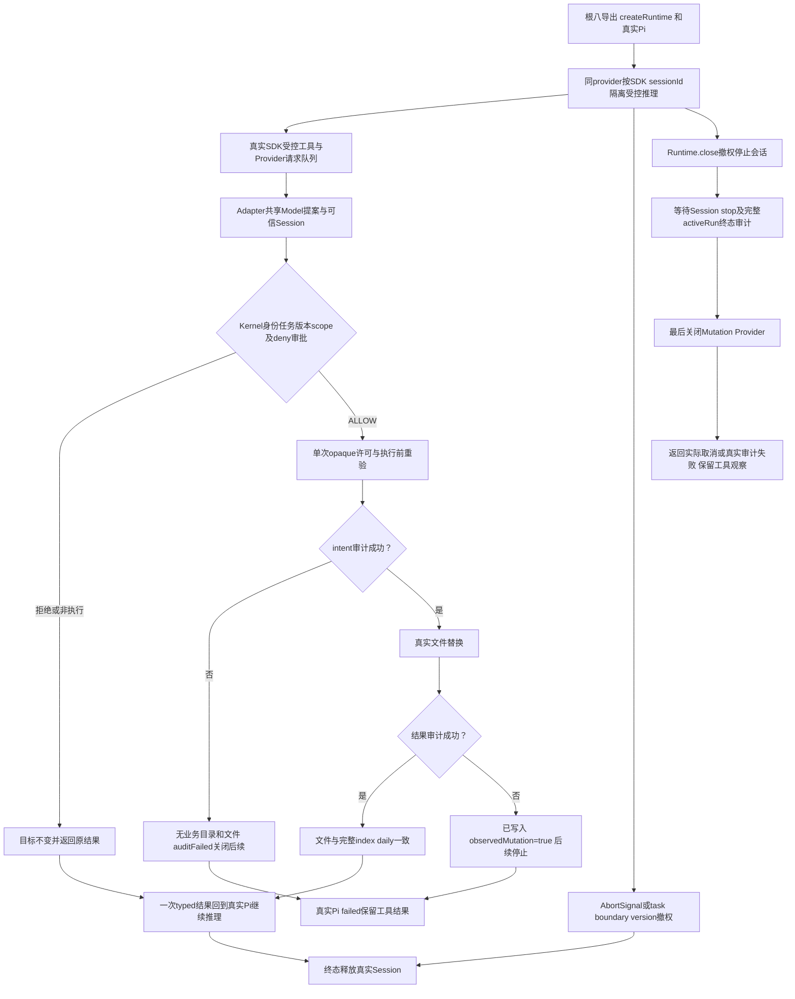

# Node/Pi v3 独立完整流程：原20项严格复验关闭修复

原20项有限套件：permission12通过、generic7通过/1失败，0跳过/取消/todo，当时完整集成未通过。Runtime.close活动Pi误报failed/kernel_audit_failed，预期cancelled/kernel_run_cancelled；缺陷由本角色复现并交原Kernel owner。现已同版修复，前六节点verified。Tester本次只更新六份文档，原20项测试及fixture不改；文档完成后的唯一approvedunit真实结果、候选与验收见 [当前关闭修复任务](../../../scheduling/legion-pi-node-v3-close-repair.md)，此处不把旧19项通过当作新组合证据。

当前Reviewer verified候选 `4d6eb703b331c5d53b10229fd464d923e73243bf9bf11b36341c6b3a8c3bdcff`，22项全通过，原关闭与真实commit后auditfault两个严格回归另2/2通过；Kernel74项全通过无skip。当前25个产品mjs统一相对路径 `/`+TAB+SHA256+LF标准聚合 `75ab247b8aafc224d39c926119e170bc56bbda966073a73eeab3bfa4a4bb8327` 来自实际Reviewer逐文件核对。关闭现在跟踪完整activeRun（含finally释放及terminal audit），同步撤权后停止Session、等待完整run，再关闭Mutation；stop不等待activeRun且run不等待Runtime.close，避免互等。真实审计错误继续failed/kernel_audit_failed和observedMutation，不被吞成取消。

原基线Reviewer `a17b4a23f05f712aca5f9d7d0cebdaa7fd37e72b7c89f1c42f02efed0a966881`、22项有限检查未发现关闭时序问题，已作为历史保留。canonical SHA256 `342fd522343126c31c7a7f1ee3c8befab9f363d5372297847ebc8f42b5f30bae`，config `25e46e9b7811685847116393d9c9982062e975f66e151ce3d094ef2be020cccb` 不变。[Reviewer报告](../../Reviewer/docs/review-node-pi-v3.md) 只读依赖；[原正式20项失败日志](../../../../.ans/runtime/legion-pi-node-v3/evidence/tester-1-unit-f97ea4f6.log) SHA256 `661e99eee49808b2ead5d8af186c80b8119e85e89d6beb4e41f0f6fc01e6d831`，原candidate `4d619ca3406c31c27e8076892545384145393c729805c1a1caa1d07001f6ef66`。[原任务](../../../scheduling/legion-pi-node-v3.md) 不改写成新验收。Windows / Node24.11.1，pi-coding-agent/pi-ai实际1.0.4，TEMP/TMP=D:/work/code-work；不使用Python产品运行。

| 文件/数量 | 有限实际检查 |
| --- | --- |
| permission12 | 根八导出、两Proposal Adapter等价、Backend保存/frontend原值保留及11事件；Session克隆/未知角色/不支持动作工具能力；case/slash与action审批及deny优先；scalar string/Uint8Array/Buffer限制抛TypeError；控制面sentinel/遍历；handoff/expansion不执行；内容资源身份ID绑定/伪造/重放；task/boundary/version回退撤权；renameSync故障旧内容与临时文件清理；intent fs.open追加故障无业务目录；commit后daily故障 observedMutation且关闭写；实际CLI原demo一成功五拒绝23事件 |
| generic8（原7通过/1失败） | 两同provider实例并行，各3次Faux推理、2个独立真实SDK Session、各自允许/越界拒绝/不同run request及typed摘要；精确role/task/scope与未知模型拒绝；payload身份字段schema拒绝与前端task越界DENY；写后活动推理取消保留原文件；三类状态撤销回退不可重跑；真实Pi intent故障零变更；真实Pi写后auditFailed保留已观察内容；Runtime close保留原严格取消断言，本次全8项与permission12一起复验 |

正常日志逐序检查kind、role/task/version/resource/digest/correlation与+08:00时间，index与每日日志逐事件镜像、日期文件清单正确；无正文/prompt/凭据/原始异常。受控推理 stream只得到SDK model/context/options，按sessionId独立Faux响应，实际prompt与dispose透明转调原SDK方法，唯一工具legion_write_file；fetch调用为0。文件及双日志均为原生Node实跑，故障注入仅fs.open/renameSync，不仿制Runtime或文件成功。

原开发检查命令见 [API](../api-spec.md)：node --test 两个integration文件，20 tests/19 pass/1 fail/0 skip，duration4326.573ms；原正式失败检查4523.3106ms、exit1。此前单permission12首次11pass/1fail，仅自有测试Error.name预期错误，改用MutationError类型，不放宽产品语义。本次不改测试或新增检查，只在六份文档完成后对原20项运行一次approvedunit；准确新结果、exit code、日志和candidate以当前任务为准，失败不能complete/verified。本角色不重跑owner74+23或PM打包套件。

原测试逐字节固定SHA256：permission `6cb2daff6047ca5194e7a7db377835dc1fa9a0d5c1ff84e43ee7eddbac41f57f`；generic `4fff06e1c509f9225ade4fc60cea008a1a266253bbd9d56375b1af665a1e444a`；fixture `787f6c845ea58755bc96c68af1ebad653b4680c1f48c54026b6cd1528d9c7dce`。本次ACK后只更新下述六份说明，不更新这三个文件。

## 原问题与同版修复：Runtime关闭与运行终态审计顺序

可复制命令：node --test --test-name-pattern='one run and Runtime close' tests/integration/test_generic_agents.mjs。第一真实实例完成后，第二真实实例的SDK推理等待支持AbortSignal的屏障、尚未发出工具。await runtime.close()，再await running；actual {status:'failed',errorCode:'kernel_audit_failed',toolResults:0}，expected cancelled/kernel_run_cancelled。完整运行与单例重跑均失败（单例208.4881ms）；严格断言保留在 [test_generic_agents.mjs](../../../../tests/integration/test_generic_agents.mjs)。

原代码定位：[runAgent](../../../../src/kernel/pipelines/permission.mjs) 当时第263–274行service.close后追加terminal audit；当时#stop第277–285行只等Adapter终止、#close第318–320行随即关闭Mutation；[Provider](../../../../src/kernel/providers/impl/storage.mjs) 第152行关闭后拒绝追加。原时序导致正常关闭被误报审计失败。issue tester-runtime-close-terminal-audit已接受stateRevision51/event legion-pi-node-v3-51；影响是取消状态/最终审计不准确，原测试未观察到越权写。当前Kernel owner修复完整activeRun等待，Reviewer22及原两严格回归已通过；本角色最后复验原20项，最终验收交Supervisor。

当前owner重打包产物 `.ans/runtime/legion-pi-node-v3/packaging/legion-runtime-0.3.0.tgz` SHA256 `a83a86499c4aaa7c997d94cabbb697efdc82f81475b622b85307ac682de4d8f0`，Reviewer逐字节核对27文件与当前产品一致，PM实际两个SDK1.0.4安装smoke通过；原b63b82b3…为历史。Tester不重打包或修改产物。临时工作区清理前验证绝对包含关系与逐组件lstat非链接并断言消失。本环境owner两个nativejunction EPERM，Reviewer仅metadata刺激，不证明native全部reparse/OS沙箱；没有新增链接用例。保证仅正常受控本地API，不覆盖恶意同进程宿主、管理员或竞争路径替换；文件/index/daily不是跨文件事务。无付费账号或外部provider请求证明。

原阶段实施三个Node integration文件与六份说明；本次仅更改feature-map、functional-description、api-spec、changelog、本阶段design和本报告六份文档。三个测试/fixture原样，九个existing outputs完整；原Python/phase1报告及其他owner只读。[本阶段方案](design/2026-10-07_design_node-pi-v3.md)、[角色导航](../feature-map.md)、[旧P1历史](../../Reviewer/docs/review.md)。
