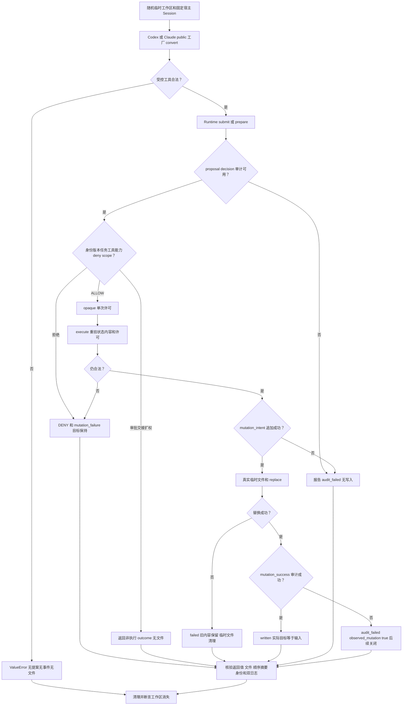

# 本地完整权限流程：17 项开发检查通过

两个本地适配器都能把固定可信 Session 的受控参数送入真实 PermissionRuntime。Backend 写 backend 的内容与摘要一致，frontend/login.vue 的原内容保持；身份和权限声明不提高权利。独立测试通过实际文件与 Provider JSONL 观察结果，未发现受测场景内的产品缺陷。最终候选、pinned unit 的真实执行和 Supervisor 验收以 [任务记录](../../../scheduling/legion-v1-approval-repair.md) 为准；本角色不自验收。

当前依赖为 Kernel `d73b364c0660fb1abcae803d3f914faeb75c8c73d2b56c231d036ea62fa584f2`（owner 47 项与 demo），Adapter `84a356064f6c36b286794604514d653cd61e4b7497500d38766e2ee4dd064476`（owner 14 项），独立 Reviewer `940e7990c3a3ff1f4e54f9389f8517c156a2c518cfecc2571b955c32310bfb78`（原样 23 项）。本次任务 legion-v1-approval-repair / tester-1，固定角色 Tester，Windows / Python 3.14.0，无 Git 元数据。原 Reviewer 源码 SHA-256 `3ecad393e318da89ac6d241c94af1bd1b62b9ce3ceef3c5b476e00c618755b9e` 只读。

| 场景 | 实际覆盖与断言 |
| --- | --- |
| 正常完整流程 | 两工厂结果/digest/Session 相同；Frontend 经真实 Runtime 初始化，Backend 保存且 frontend 原内容不变；11 个完整事件 |
| 身份与受控工具 | 参数伪称 role/session/task/version/action/capability/tool/authority 不授予权利；Session 副本、未注册、已注册但角色未知拒绝；未知 Adapter 工具无副作用；Runtime 不支持动作工具能力及缺少权利拒绝 |
| 权限路径 | deny 先于审批交接扩权；.ANS/organization sentinel 不变，遍历无文件；旧 Session 版本拒绝，decision 事件使用当前版本 |
| 非执行结果与 P1 回归 | 正斜杠、反斜杠、大小写审批别名与 action 审批都 REQUIRE_APPROVAL；合法交接目标、扩权、未知交接目标的结果均不写入；str/bytes/bytearray 限制集合拒绝后原 deny/approval 仍生效 |
| 分离准备执行 | prepare 不创建业务目录；内容变化、伪许可、重放拒绝；新许可实际成功；task/boundary/version 改变后拒绝，回退也不能恢复旧许可 |
| 真实文件失败 | 已有非目录父组件被保留；实际 os.replace 受控抛 OSError，返回 failed，旧内容和 failure 审计完整且临时文件已清理 |
| 审计前后失败 | Path.open 实际追加失败在 intent 时无业务目录；结果 daily append 失败后文件已变且 observed_mutation=true；index/daily 分裂让 events 抛 MutationError，后续提案 audit_unavailable 且不创建目标 |
| EventLog | 正常与拒绝事件全序号、kind、role/task/version/resource/digest/correlation；Provider +08:00 时间，index 与日期 JSONL 镜像一致，无正文或原异常秘密 |
| 原 Interface demo | 真实 run_demo 复测 backend_written/frontend_preserved，1 ALLOW 和 5 DENY，status/原因/observed_mutation 与 23 个有序事件符合原合同 |

准确复现命令见 [API](../api-spec.md)。开发实际 unittest discover('tests/integration') 第二轮运行 17 项，0 跳过、退出码 0，5.696s。首轮 17 项中一个方法因自有 helper session 参数冲突报两子例 TypeError，产品 API 尚未被调用；仅修正 helper 名称后通过，未修改断言。六份文档随后完成，最终再运行任务配置 pinned unit，日志与 candidate 由 task_ops 自动记录到上方任务记录，不在本报告复制原始日志或私有 token。

实现仅 [tests/integration/test_permission_flow.py](../../../../tests/integration/test_permission_flow.py) 和 Tester 六份文档。原 P1/失败历史见 [Reviewer 报告](../../Reviewer/docs/review.md)，修复来自原 Kernel owner。没有真实厂商 envelope/streaming、CLI Agent、付费账号或外部服务调用；没有创建真实 Windows junction/symlink，Reviewer/Kernel 的受控检测分支证据不能表述为真实宿主链接隔离。保证针对正常公开本地 API，未验证恶意共享进程、管理员、并发路径竞争或上级目录替换；审计与目标三个文件没有事务。临时空间在 D:/work/code-work 下随机创建并清理，原演示由 Provider 管理临时生命周期。依赖后续变化必须刷新证据。
